# Boca en el arte — Museo Xeneize

Un museo imaginario: diez pinturas clásicas con la ropa repintada de azul y oro, colgadas en una sala 3D que se recorre con el scroll y termina en una maqueta del estadio.

**Verlo:** https://meryboth.github.io/boca-en-el-arte/

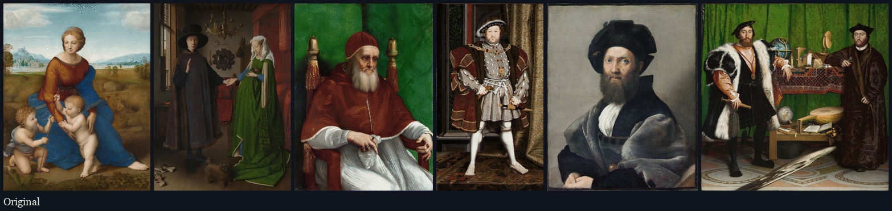

*Seis de las diez obras: el original y la versión que cuelga en la sala.*

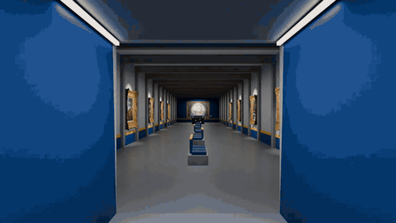

*El recorrido completo, acelerado. En el sitio avanza con el scroll.*

**Proyecto no oficial.** No tiene relación con ningún club. No usa escudos, marcas, sponsors ni nombres de jugadores.

Este repo contiene solo el sitio ya construido. Abajo está el resumen técnico de la investigación que lo produjo.

## Qué se investigó

El punto de partida era probar dos herramientas sobre algo publicable: **Claude Fable 5.2** como "artista generativo" y **Tesseract** (Mirage) para 3D. De ahí salieron un experimento formal y cuatro relatos de construcción:

1. ¿Quién repinta mejor la ropa de una pintura real: código, un modelo de imagen o los dos combinados?
2. Qué aporta Tesseract a una escena armada en Blender.
3. Una sala 3D y un sitio hechos enteramente por script.
4. Cuatro caminos para conseguir una maqueta del estadio.
5. Dos pipelines guardados en ComfyUI.

## Con qué se hizo

| Pieza | Herramienta | Para qué |
|---|---|---|
| Dirección, agentes y código | Claude Fable 5.2 (Claude Code) | Scripts, configuración del recoloreo, sala, sitio y maqueta |
| Edición de imagen | Nano Banana 2 (Gemini 3.1 Flash Image), nodo de Comfy Cloud, 4K | Repintar la ropa |
| Recoloreo determinista | Script propio en CIELAB: polígonos y clave de color por zona | Método `code` |
| Imagen a 3D | Tripo v3.1 multivista y Rodin Gen-2.5, vía Comfy Cloud | Intentos de maqueta |
| Sala y recorrido | Blender 5.1.2 sin interfaz, EEVEE | 1.621 cuadros e imágenes fijas por parada |
| Video | Tesseract CLI 0.7.0, path tracer, 48 muestras, 1080p, 24 fps | Teaser de la portada |
| Sitio | HTML estático: un `canvas` y 541 cuadros WebP | Recorrido con scroll, 43 MB |
| Hosting | GitHub Pages | Publicación |

Máquina: Ryzen 9 4900HS, RTX 2060 Max-Q (6 GB), 15,4 GB de RAM, Windows 11. Todos los tiempos son de una sola medición en esta máquina.

## El experimento: código vs. modelo de imagen vs. combinado

El primer piloto hizo que el modelo de lenguaje dibujara una pintura "renacentista" entera por código. No era realista ni lo buscado, y el protocolo se reescribió con una pregunta más acotada: dada una pintura real, ¿quién debe cambiar la ropa?

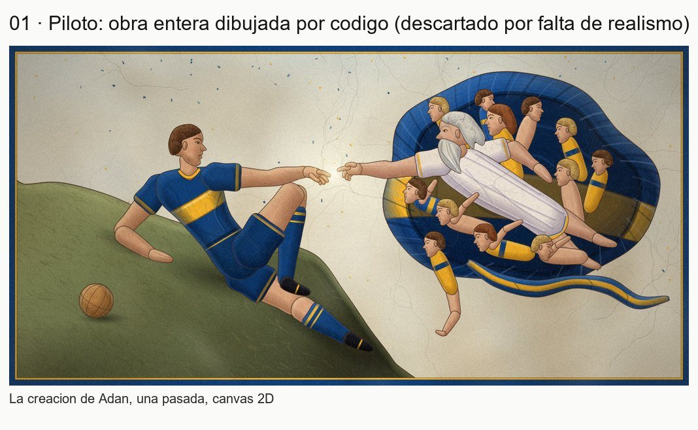

**Tres métodos** sobre el mismo archivo fuente (lado largo 4.500 px):

| Condición | Quién pinta | Itera | Costo por imagen (mediana) |
|---|---|---|---|
| `edit` (baseline) | Nano Banana 2, un prompt congelado por pintura | no | 38,46 créditos |
| `code` | script de recoloreo; la configuración la escribe un agente nuevo por intento | hasta 4 rondas | 133.900 tokens, 512 s |
| `hybrid` | la ropa de `edit` pegada sobre el original con la máscara de `code` | no | reutiliza los dos anteriores |

**Diseño:** 4 pinturas × 3 métodos × 5 semillas = 60 corridas. Una quinta pintura se usó solo para desarrollar el script. Regla fija: se tocan solo telas, no sillas ni objetos.

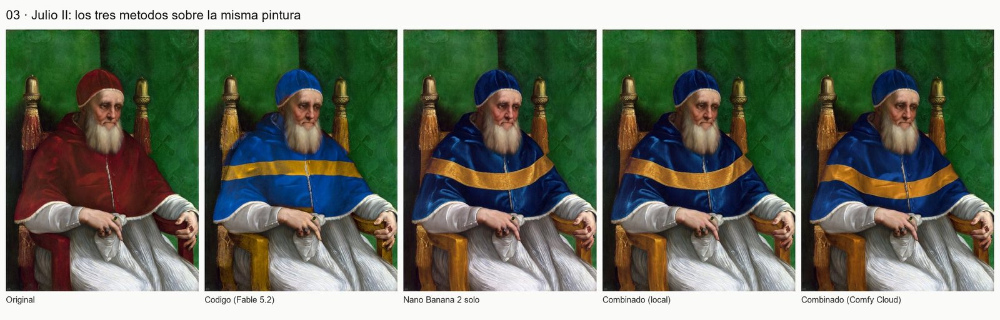

*De izquierda a derecha: original, código, modelo de imagen solo y dos variantes del combinado.*

**Métricas automáticas**, sobre parches chicos definidos antes de correr:

- **Alteración:** mediana CIEDE2000 contra el original en caras, manos y fondo. Más bajo es mejor.
- **Error de matiz:** distancia en grados al azul u oro buscado, en la ropa. Más bajo es mejor.
- **Pliegues:** correlación de la luminosidad con el original, en la ropa. Más alto es mejor.

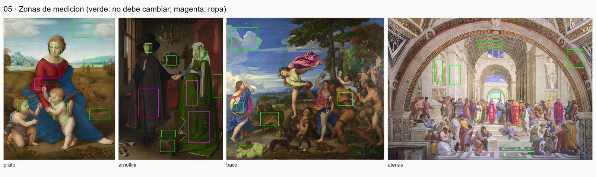

*Verde: zonas que no deben cambiar. Magenta: ropa.*

| Las cuatro pinturas, n = 20 | `edit` | `code` | `hybrid` |
|---|---|---|---|
| Alteración (ΔE00) | 5,19 | 0,00 | 0,00 |
| Error de matiz | 12,7° | 0,9° | 12,6° |
| Pliegues | 0,83 | 0,91 | 0,85 |

**Evaluación humana a ciegas:** una evaluadora, 60 pares ("¿cuál colgarías?") y 60 imágenes sueltas ("¿se nota algo retocado?"), en orden aleatorio y sin etiquetas.

| Par | Total | Intervalo 95 % del primero | Veredicto |
|---|---|---|---|
| `code` vs `edit` | 9–11 | 25,0 % – 65,0 % | sin ganador |
| `hybrid` vs `code` | 11–9 | 35,0 % – 75,0 % | sin ganador |
| `hybrid` vs `edit` | 11–5 (4 sin decidir) | 43,8 % – 87,5 % | sin ganador |

"Se nota retocado": `code` 5 de 20 (los cinco intentos de una misma pintura), `edit` 0 de 20, `hybrid` 0 de 20.

### Qué salió

- **El modelo de imagen cambia lo que debía dejar intacto** (confirmado): 5,2 ΔE00 en caras, manos y fondo, contra un umbral de 2,0 fijado de antemano. Además devuelve la imagen en otro tamaño (0,92× a 1,67× los píxeles del original).
- **No hubo método ganador.** El 9–11 esconde dos goleadas opuestas: en las dos pinturas con pocas prendas grandes el modelo ganó todos los pares; en las dos con muchas figuras o tela mezclada con piel, el código ganó 9 de 10. Con una pintura por nivel de dificultad, esto es un estudio de casos y no una regla.
- **El combinado no le ganó a los dos.**
- **Acertar el color no fue lo que se premió.** El código acierta el matiz mucho mejor (0,9° contra 12,7°) y aun así perdió donde la tela quedaba plana.
- **Una métrica resultó equivocada.** La de pliegues le dio su mejor puntaje (0,99) a las imágenes que la evaluadora marcó como retocadas: no sirve para tela oscura.
- Que `code` y `hybrid` den ~0 de alteración es por construcción (copian el original fuera de la máscara), no un hallazgo.
- Una de las hipótesis del protocolo (si la clave de color importa) no se probó: la ablación se canceló por presupuesto.

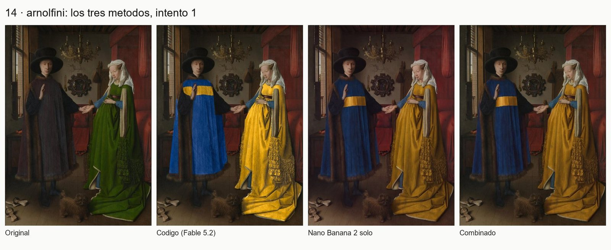

*Pocas prendas grandes: acá la evaluadora prefirió al modelo de imagen en todos los pares.*

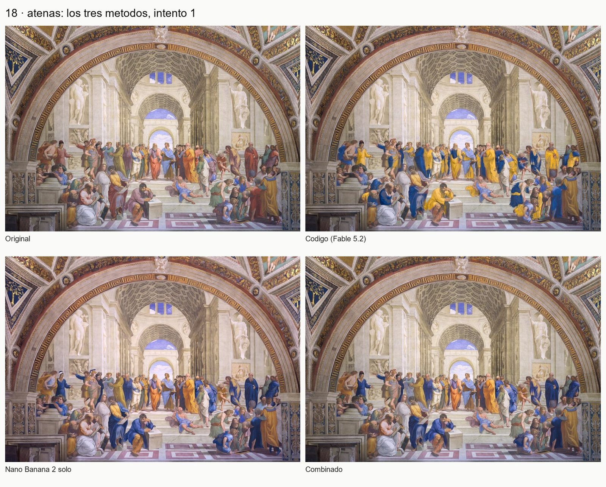

*Muchas figuras: acá prefirió al código en todos los pares.*

### Qué cuelga en el museo

| Obra | Método |
|---|---|
| Madonna del Prato, Matrimonio Arnolfini, Baco y Ariadna | Combinado, del experimento |
| La escuela de Atenas | Código |
| Retrato de Julio II | Combinado |
| La dama del armiño, Baltasar Castiglione, Eleonora de Toledo, Los embajadores, Enrique VIII | Combinado con máscara automática |

La variante de máscara automática (la máscara sale de dónde el modelo cambió el matiz) **no se midió ni se evaluó**: está en la sala porque se quisieron más obras. Enrique VIII reemplazó a la Gioconda, cuyo vestido ya era oscuro y casi no mostraba la intervención.

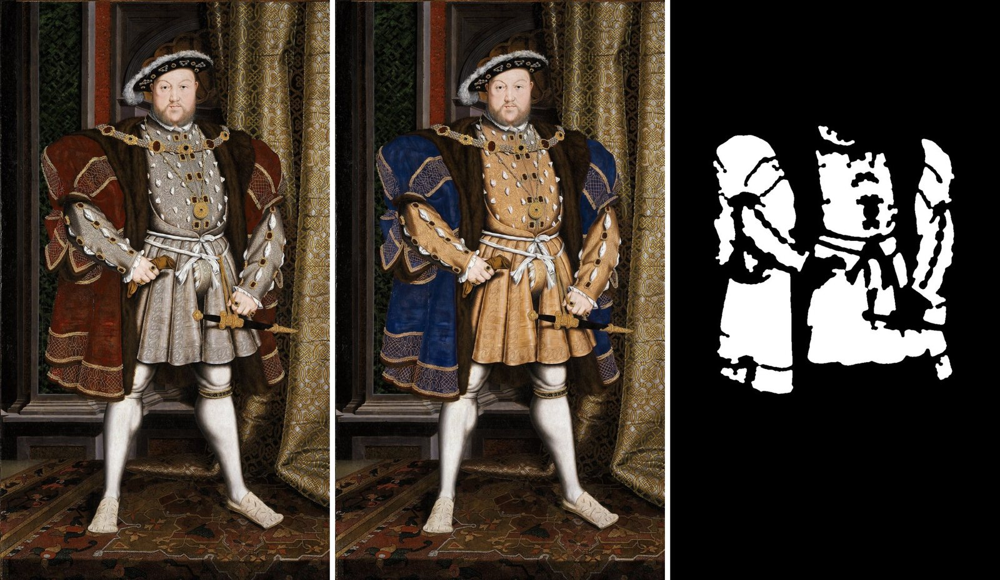

*Máscara automática: en blanco, la zona del resultado del modelo que se pega sobre el original.*

## Tesseract

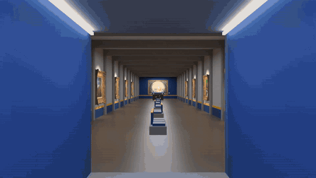

*El teaser, renderizado con path tracing. Acá a menor resolución y sin la calidad del video original.*

- La sala se arma en Blender; Tesseract renderiza el video. Al importar el `.blend` se perdieron las luces de área, los materiales procedurales y la restricción de cámara; las luces se rehicieron en watts.
- El path tracer se quedaba sin memoria en la placa de 6 GB hasta bajar todas las texturas a 1.280 px.
- Un cuadro 1080p: 22,4 s con 16 muestras, 37,5 s con 48 y 75,2 s con 128.
- Teaser final: 5 planos, 408 cuadros, 17 s, un proyecto por plano unidos con ffmpeg. Se renderizaron 6 y uno se descartó.
- Exportarlo fue el paso menos confiable: 4,3 h para los 6 planos (28,1 a 35,9 s por cuadro). Un plano falló dos veces, una con "GPU device lost" y otra colgado unas 40 h sin dar error. Se resolvió con un vigilante que corta el export a los 600 s sin cuadro nuevo. La causa de las dos fallas no se conoce.
- La luz rebotada es claramente mejor que la del render en tiempo real; la geometría sigue siendo simple. No es fotorrealista.

## Sala y sitio

- Un solo script arma paredes, túnel, vigas, lucernarios, marcos, cámara y paradas; no hay archivo de Blender editado a mano.
- Casi todo se rehízo tras revisarlo: ornamentos generados por código → marcos escaneados; piso con vetas → cemento alisado; paneo de cámara → un cuerpo que camina, se balancea y gira hacia cada obra; lienzos pixelados → fuentes de 3.840 px e imágenes fijas de 2.880 px.
- Render final: 1.621 cuadros en 85 min (3,1 s por cuadro).
- El sitio no corre 3D en vivo: muestra cuadros pre-renderizados según el scroll, una imagen fija de alta resolución en cada parada y un visor para la obra sola.

## La maqueta del estadio: cuatro caminos

| Camino | Resultado | Aceptado | Costo |
|---|---|---|---|
| 1. Cubos colocados por código, 3 versiones | reconocible, proporciones a ojo | no | 0 |
| 2. Modelo ya hecho | ninguno gratis y reutilizable a la vez | no | 0 |
| 3a. Vistas normalizadas con Nano Banana 2 + Tripo | 167.744 vértices; nítido, planta y dorso inventados | no | 102,2 créditos |
| 3b. Rodin Gen-2.5 sobre fotos reales | 600.556 vértices; mejor planta, gradas blandas | no | 158,25 créditos |
| 4. Modelo limpio desde una ficha de medidas | 23.902 caras en 9 objetos | sí | 0 |

- **El cuarto camino es el aporte:** la malla generada se midió en vez de usarse. Los vértices verdes dan la cancha (origen, ejes y escala de 105 m) y de ahí salen el contorno, ocho cortes y la altura del borde (~34 m). Con esas medidas, cada una con su fuente y su nivel de confianza, se modeló barriendo perfiles a lo largo de la planta.
- La malla de origen tiene ~6 % de error en la única dimensión que se pudo controlar (cancha de 72,1 m de ancho en vez de 68).
- Para un edificio, la imagen a 3D no dio un modelo usable: sirvió como instrumento de medición.
- Fallas registradas: el recorte automático de las fotos falló en 5 de 7; la normalización de vistas dio una buena de tres; 2 de 5 corridas 3D fallaron por errores al armar el grafo; un servicio agregó un escudo y una marca que no se habían pedido, y se taparon.
- Con un objeto, una corrida por camino y una persona juzgando, no se puede decir qué servicio de imagen a 3D es mejor.

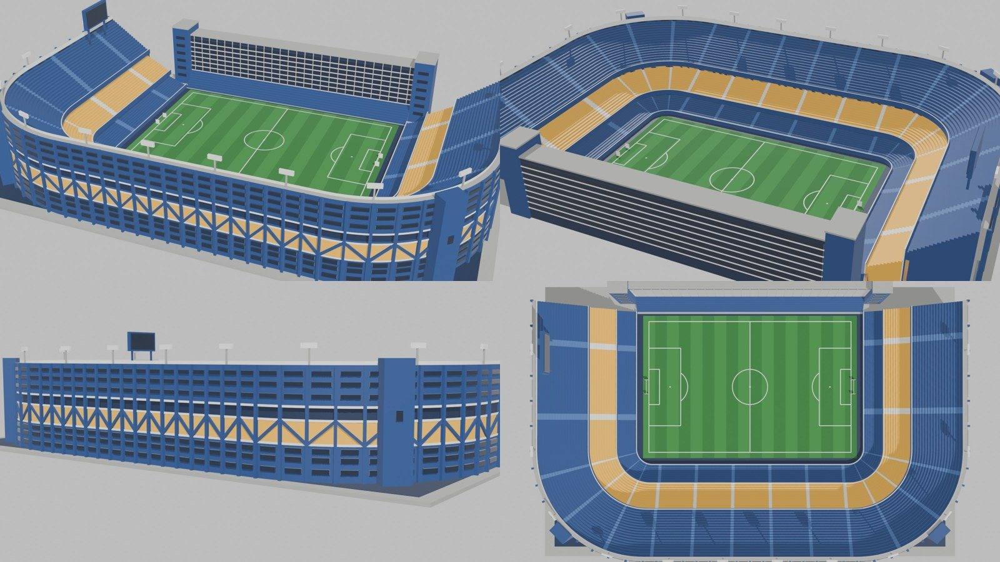

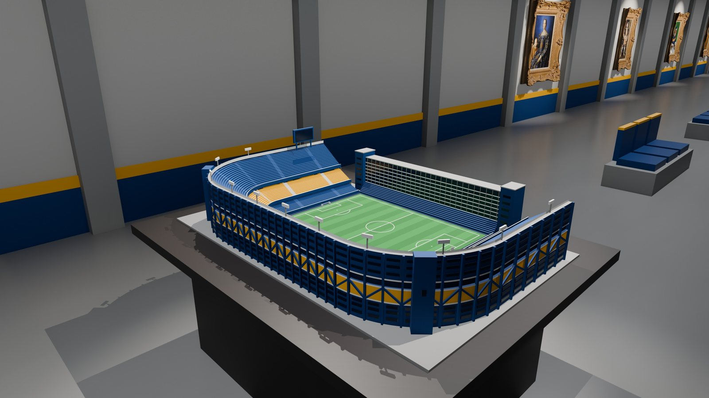

## Costos

| Etapa | Corridas | Costo |
|---|---|---|
| Pilotos | 6 | 76,99 créditos |
| Evaluación `edit` | 20 | 769,26 créditos |
| Evaluación `code` | 20 agentes | 2.898.475 tokens, 3,6 h de agente |
| Evaluación `hybrid` | 20 | 0 |
| Cinco pinturas más y un reemplazo | 6 | 230,72 créditos |
| Estadio, imagen a 3D | 5 (2 fallidas) | 260,45 créditos |
| Sala, video, sitio y maqueta limpia | — | 0 (máquina propia) |
| **Total** | **77** | **1.337,42 créditos + 2,90 M tokens** |

Los créditos son la cifra de Comfy Cloud por trabajo, no un monto facturado. No se cuentan los tokens de la conversación que dirigió el trabajo. Las corridas fallidas y descartadas están incluidas.

## Límites

- **Una sola evaluadora, que es la autora del proyecto, y rápida:** 120 respuestas en 259 s. Conocía los métodos.
- **El baseline no pudo iterar y el código sí** (hasta 4 rondas). Eso favorece al código, que igual no ganó.
- **Las semillas emparejan solo de nombre:** el modelo de imagen no devuelve la misma imagen con la misma semilla.
- **Cuatro pinturas, una por nivel de dificultad.**
- **Las métricas no se validaron contra una persona** antes de usarlas.
- **La mitad del museo no está medida** (las obras con máscara automática).
- **La maqueta no es un relevamiento del edificio.**
- **No hecho:** sonido del teaser, prueba en celulares y en Safari, segunda evaluadora.

## Qué hay en este repo

- `index.html` — la página completa.
- `frames/` — el recorrido de la sala, cuadro por cuadro.
- `paradas/` — una imagen de alta resolución por cada obra.
- `obras/` — las obras solas, para verlas en grande.
- `intro.mp4` — el teaser de la portada (sin sonido).
- `readme/` — las imágenes y los GIFs de este README; el sitio no los usa.

Es un sitio estático: no hay que instalar ni compilar nada. Para verlo en local:

```
python -m http.server 8000
```

y abrir http://localhost:8000. El código que genera la sala, los datos del experimento y las bitácoras no están en este repo.

## Créditos y licencias

- Las pinturas originales están en dominio público (vía Wikimedia Commons). Acá aparecen intervenidas: solo se cambió el color de las telas.
- Marcos: Poly Haven, CC0.
- La maqueta del estadio se modeló tomando como referencia fotos aéreas de ProtoplasmaKid (Wikimedia Commons, CC BY-SA 4.0).
