# Museo Xeneize · classical paintings in blue and gold, and the room built to hang them

<!-- Generated from report.template.md by scripts/render_report.py with the numbers of report-data.json. Do not edit report.md by hand. -->

*Open R&D · generative art, image-to-3D and a pre-rendered museum · 2026 · unofficial fan project: no crest, no sponsors, no player names.*

Ten public-domain paintings get their clothes repainted in blue and gold, hang in a 3D room built entirely by script, and end at a scale model of the stadium. Along the way one question was tested properly — who repaints a Renaissance robe better, code or an image model? — and the answer was **neither**: across {{eval.pairs.code_vs_edit.n_decided}} blind pairs the code won {{eval.pairs.code_vs_edit.wins_first}} and the image model {{eval.pairs.code_vs_edit.wins_second}}, a tie that hides a clean split by painting. The rest is an honest build log: what Claude Fable 5.2 could and could not do as a "generative artist", what Tesseract added, and four attempts at one stadium.

## Results at a glance

| Number | What it is | n | Comes from |
|---|---|---|---|
| {{exp.conditions.edit.summary.alteracion.median|.1f}} ΔE00 | How much Nano Banana 2 changes faces, hands and background it was told to leave alone (median; the limit set beforehand was {{extra.threshold_h2|.1f}}) | {{exp.conditions.edit.n}} edits | Table 2 |
| {{eval.pairs.code_vs_edit.wins_first}} – {{eval.pairs.code_vs_edit.wins_second}} | Code vs. image model in blind pairs: no winner (95 % interval {{eval.pairs.code_vs_edit.ci95.0|pct}} to {{eval.pairs.code_vs_edit.ci95.1|pct}}) | {{eval.pairs.code_vs_edit.n_decided}} pairs, one evaluator | Table 3 |
| {{eval.singles.code.flagged}} of {{eval.singles.code.n}} | Code recolours flagged as "visibly retouched" — all five attempts on one painting; {{eval.singles.edit.flagged}} of {{eval.singles.edit.n}} for the image model | {{eval.singles.code.n}} per method | Table 3 |
| 4 | Routes tried for the stadium model: cubes by eye, a ready-made model, two image-to-3D services, a clean model from a building sheet — the one Marilyn accepted | 1 object | Table 5 |
| {{credits.total|int}} credits + {{agents.tokens_M|.2f}} M tokens | Everything paid: {{runs.total}} logged runs, failed and discarded ones included | {{runs.total}} runs | Table 6 |

## Where it started, and the first thing that failed

The brief was to try two tools on something hostable: **Claude Fable 5.2** as a generative artist and **Tesseract** (Mirage) for 3D. Fable writes code and text, not pixels, so the first pilot had it draw a whole "Renaissance" painting in code. Marilyn's verdict: not realistic, and not what she wanted — she wanted *real* paintings with the shirt added (run `p0001`, kept in the log; protocol v1 is archived).

That rewrote the project. Protocol v2 asks a narrower question: given a real painting, **who should change the clothes** — deterministic code written by an agent, an image-editing model, or both?

## The three methods

- **`edit` (baseline).** Nano Banana 2 (Gemini 3.1 Flash Image) from a Comfy Cloud node, 4K, one frozen prompt per painting, no iteration. It is the naive alternative: hand the picture to a model and ask.
- **`code`.** A fresh Fable 5.2 agent per attempt writes the config for a frozen CIELAB recolouring script (polygons, a colour key per region, levels), looks at the result and corrects it, up to four rounds. Outside the mask every pixel is the original.
- **`hybrid`.** The clothes from the `edit` output pasted onto the original through the mask of the `code` attempt with the same seed, after registering both images. Added after the pilots, at Marilyn's request: the model painted better cloth, the code protected better faces.

Only fabric is touched — no chairs, no objects (a rule Marilyn set during the pilots). Four evaluation paintings, five seeds each, {{exp.n_ok}} runs; a fifth painting (Raphael's *Julius II*) was used only to develop the script.

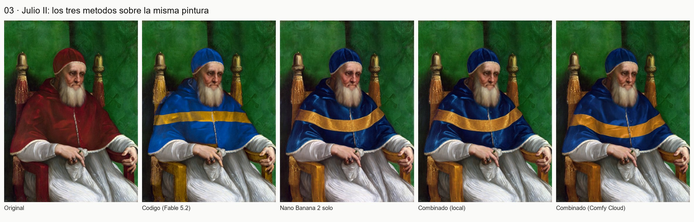

**Table 1 — conditions.** Same source file (long side 4500 px) for all three.

| Condition | Who paints | Iterates | Cost per image |
|---|---|---|---|
| `edit` | Nano Banana 2 | no (frozen prompt) | {{exp.conditions.edit.summary.credits.median|.2f}} credits |
| `code` | recolour script, config by a Fable agent | up to 4 rounds (median {{exp.conditions.code.summary.script_runs.median|.0f}}) | {{exp.conditions.code.summary.tokens_total.median|int}} tokens, {{exp.conditions.code.time_s.median|.0f}} s (medians) |
| `hybrid` | model inside the mask, original outside | no | reuses both of the above |

## What the metrics say

Three automatic metrics on small frozen patches drawn before any run: **alteration** (median CIEDE2000 against the original inside protected patches — faces, hands, background; lower is better), **hue error** (median hue-angle distance to the brand blue or gold in clothing patches, degrees; lower is better) and **folds** (Pearson correlation of L* with the original in clothing patches; higher is better). None of them is a gate.

**Table 2 — medians per painting, n = 5 seeds per cell.**

| Painting | Alteration `edit` | `code` | `hybrid` | Hue error `edit` | `code` | `hybrid` | Folds `edit` | `code` | `hybrid` |
|---|---|---|---|---|---|---|---|---|---|
| Madonna del Prato | {{exp.conditions.edit.by_case.prato.alteracion.median|.2f}} | {{exp.conditions.code.by_case.prato.alteracion.median|.2f}} | {{exp.conditions.hybrid.by_case.prato.alteracion.median|.2f}} | {{exp.conditions.edit.by_case.prato.tono.median|.1f}}° | {{exp.conditions.code.by_case.prato.tono.median|.1f}}° | {{exp.conditions.hybrid.by_case.prato.tono.median|.1f}}° | {{exp.conditions.edit.by_case.prato.pliegues.median|.2f}} | {{exp.conditions.code.by_case.prato.pliegues.median|.2f}} | {{exp.conditions.hybrid.by_case.prato.pliegues.median|.2f}} |
| Arnolfini Portrait | {{exp.conditions.edit.by_case.arnolfini.alteracion.median|.2f}} | {{exp.conditions.code.by_case.arnolfini.alteracion.median|.2f}} | {{exp.conditions.hybrid.by_case.arnolfini.alteracion.median|.2f}} | {{exp.conditions.edit.by_case.arnolfini.tono.median|.1f}}° | {{exp.conditions.code.by_case.arnolfini.tono.median|.1f}}° | {{exp.conditions.hybrid.by_case.arnolfini.tono.median|.1f}}° | {{exp.conditions.edit.by_case.arnolfini.pliegues.median|.2f}} | {{exp.conditions.code.by_case.arnolfini.pliegues.median|.2f}} | {{exp.conditions.hybrid.by_case.arnolfini.pliegues.median|.2f}} |
| Bacchus and Ariadne | {{exp.conditions.edit.by_case.baco.alteracion.median|.2f}} | {{exp.conditions.code.by_case.baco.alteracion.median|.2f}} | {{exp.conditions.hybrid.by_case.baco.alteracion.median|.2f}} | {{exp.conditions.edit.by_case.baco.tono.median|.1f}}° | {{exp.conditions.code.by_case.baco.tono.median|.1f}}° | {{exp.conditions.hybrid.by_case.baco.tono.median|.1f}}° | {{exp.conditions.edit.by_case.baco.pliegues.median|.2f}} | {{exp.conditions.code.by_case.baco.pliegues.median|.2f}} | {{exp.conditions.hybrid.by_case.baco.pliegues.median|.2f}} |
| The School of Athens | {{exp.conditions.edit.by_case.atenas.alteracion.median|.2f}} | {{exp.conditions.code.by_case.atenas.alteracion.median|.2f}} | {{exp.conditions.hybrid.by_case.atenas.alteracion.median|.2f}} | {{exp.conditions.edit.by_case.atenas.tono.median|.1f}}° | {{exp.conditions.code.by_case.atenas.tono.median|.1f}}° | {{exp.conditions.hybrid.by_case.atenas.tono.median|.1f}}° | {{exp.conditions.edit.by_case.atenas.pliegues.median|.2f}} | {{exp.conditions.code.by_case.atenas.pliegues.median|.2f}} | {{exp.conditions.hybrid.by_case.atenas.pliegues.median|.2f}} |
| **All four** (n = {{exp.conditions.edit.n}}) | **{{exp.conditions.edit.summary.alteracion.median|.2f}}** | **{{exp.conditions.code.summary.alteracion.median|.2f}}** | **{{exp.conditions.hybrid.summary.alteracion.median|.2f}}** | **{{exp.conditions.edit.summary.tono.median|.1f}}°** | **{{exp.conditions.code.summary.tono.median|.1f}}°** | **{{exp.conditions.hybrid.summary.tono.median|.1f}}°** | **{{exp.conditions.edit.summary.pliegues.median|.2f}}** | **{{exp.conditions.code.summary.pliegues.median|.2f}}** | **{{exp.conditions.hybrid.summary.pliegues.median|.2f}}** |

> Runs `e0001`–`e0060` in `runs.jsonl`, seeds 1–5, measured with `scripts/measure.py` on the frozen patches of `zones/zones.json`. `edit` outputs resized to the original before measuring. Paired by seed against `edit`: alteration {{exp.vs_baseline.code.alteracion.median_diff|.2f}} for `code` (95 % interval {{exp.vs_baseline.code.alteracion.ci95.0|.2f}} to {{exp.vs_baseline.code.alteracion.ci95.1|.2f}}); hue error {{exp.vs_baseline.code.tono.median_diff|.1f}}° for `code` ({{exp.vs_baseline.code.tono.ci95.0|.1f}} to {{exp.vs_baseline.code.tono.ci95.1|.1f}}) and {{exp.vs_baseline.hybrid.tono.median_diff|.2f}}° for `hybrid` ({{exp.vs_baseline.hybrid.tono.ci95.0|.2f}} to {{exp.vs_baseline.hybrid.tono.ci95.1|.2f}}: no winner).

How to read it, including what is true by construction:

- **The image model does touch what it should not** (H2, confirmed): {{exp.conditions.edit.summary.alteracion.median|.1f}} ΔE00 against a limit of {{extra.threshold_h2|.1f}}, worst patch in any edit {{exp.conditions.edit.summary.alteracion_max.max|.1f}}. It also returns a different size ({{exp.conditions.edit.summary.resolucion.min|.2f}}× to {{exp.conditions.edit.summary.resolucion.max|.2f}}× the original pixels).
- `code` and `hybrid` score ~0 on alteration **because they copy the original outside the mask**. That is the design, not a finding.
- `hybrid` matches `edit` on hue for the same reason in reverse: it *is* the model's cloth.
- The code hits the brand hue far better ({{exp.conditions.code.summary.tono.median|.1f}}° vs {{exp.conditions.edit.summary.tono.median|.1f}}°) — and that turned out not to be what a viewer rewards.

## What a person preferred

Blind page, random order, no labels: {{eval.pairs_answered}} pairs ("which would you hang?") and {{eval.singles_answered}} single images ("does anything look retouched?").

**Table 3 — pairs won, by painting.** First number is the first method named.

| Pair | Prato | Arnolfini | Bacchus | Athens | Total | 95 % interval for the first | Verdict |
|---|---|---|---|---|---|---|---|
| `code` vs `edit` | {{eval.pairs.code_vs_edit.by_case.prato.first}}–{{eval.pairs.code_vs_edit.by_case.prato.second}} | {{eval.pairs.code_vs_edit.by_case.arnolfini.first}}–{{eval.pairs.code_vs_edit.by_case.arnolfini.second}} | {{eval.pairs.code_vs_edit.by_case.baco.first}}–{{eval.pairs.code_vs_edit.by_case.baco.second}} | {{eval.pairs.code_vs_edit.by_case.atenas.first}}–{{eval.pairs.code_vs_edit.by_case.atenas.second}} | {{eval.pairs.code_vs_edit.wins_first}}–{{eval.pairs.code_vs_edit.wins_second}} | {{eval.pairs.code_vs_edit.ci95.0|pct}} – {{eval.pairs.code_vs_edit.ci95.1|pct}} | no winner |
| `hybrid` vs `code` | {{eval.pairs.hybrid_vs_code.by_case.prato.first}}–{{eval.pairs.hybrid_vs_code.by_case.prato.second}} | {{eval.pairs.hybrid_vs_code.by_case.arnolfini.first}}–{{eval.pairs.hybrid_vs_code.by_case.arnolfini.second}} | {{eval.pairs.hybrid_vs_code.by_case.baco.first}}–{{eval.pairs.hybrid_vs_code.by_case.baco.second}} | {{eval.pairs.hybrid_vs_code.by_case.atenas.first}}–{{eval.pairs.hybrid_vs_code.by_case.atenas.second}} | {{eval.pairs.hybrid_vs_code.wins_first}}–{{eval.pairs.hybrid_vs_code.wins_second}} | {{eval.pairs.hybrid_vs_code.ci95.0|pct}} – {{eval.pairs.hybrid_vs_code.ci95.1|pct}} | no winner |
| `hybrid` vs `edit` | {{eval.pairs.hybrid_vs_edit.by_case.prato.first}}–{{eval.pairs.hybrid_vs_edit.by_case.prato.second}} | {{eval.pairs.hybrid_vs_edit.by_case.arnolfini.first}}–{{eval.pairs.hybrid_vs_edit.by_case.arnolfini.second}} | {{eval.pairs.hybrid_vs_edit.by_case.baco.first}}–{{eval.pairs.hybrid_vs_edit.by_case.baco.second}} | {{eval.pairs.hybrid_vs_edit.by_case.atenas.first}}–{{eval.pairs.hybrid_vs_edit.by_case.atenas.second}} | {{eval.pairs.hybrid_vs_edit.wins_first}}–{{eval.pairs.hybrid_vs_edit.wins_second}} ({{eval.pairs.hybrid_vs_edit.undecided}} undecided) | {{eval.pairs.hybrid_vs_edit.ci95.0|pct}} – {{eval.pairs.hybrid_vs_edit.ci95.1|pct}} | no winner |

> One evaluator (Marilyn), {{eval.pairs.code_vs_edit.n_pairs}} pairs per comparison, bootstrap intervals over attempts. "Visibly retouched": `code` {{eval.singles.code.flagged}}/{{eval.singles.code.n}}, `edit` {{eval.singles.edit.flagged}}/{{eval.singles.edit.n}}, `hybrid` {{eval.singles.hybrid.flagged}}/{{eval.singles.hybrid.n}}. Source: `eval-results.json`.

- **H1 (people prefer the code): not confirmed.** {{eval.pairs.code_vs_edit.wins_first}}–{{eval.pairs.code_vs_edit.wins_second}} overall. But the tie is two opposite landslides: on the two paintings with a few large garments the image model won every pair; on the two with many figures or cloth tangled with skin the code won nine of ten. With one painting per level this is a case study, not a law.
- **H4 (the hybrid beats both): not confirmed.** Against the code it repeats the model's pattern: it wins Prato and Arnolfini and loses the other two. Against the model itself it is {{eval.pairs.hybrid_vs_edit.wins_first}}–{{eval.pairs.hybrid_vs_edit.wins_second}} with {{eval.pairs.hybrid_vs_edit.undecided}} pairs she could not tell apart, and the interval still includes 50 %.
- **H3 (the colour key matters): not tested.** The ablation was dropped to stay inside the token budget after the first half cost {{agents.tokens_M|.2f}} M tokens.
- All five code attempts on the Arnolfini were flagged as retouched: recolouring a dark green velvet towards blue leaves it flat. The metric that should see that (folds) gave those images its *best* score ({{exp.conditions.code.by_case.arnolfini.pliegues.median|.2f}}). The metric is wrong for dark cloth.

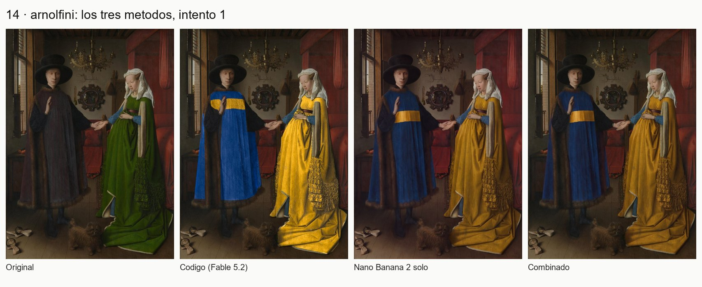
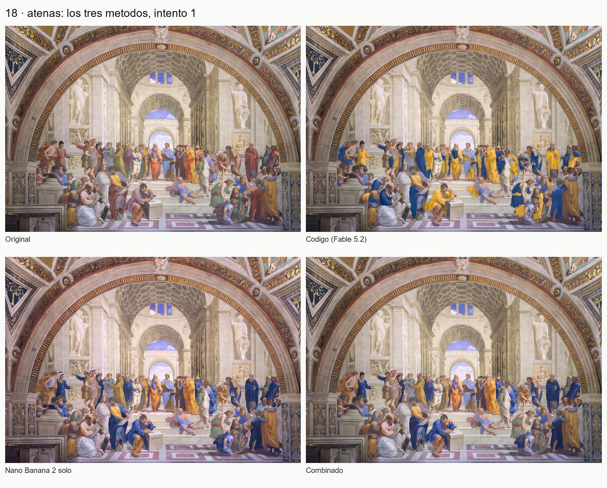

What hangs in the museum follows that split, not a single method: hybrid for three paintings, code for *The School of Athens*. Five more paintings were added later with an automatic variant (the mask derived from where the model changed hue, no agent). That variant **was never measured or evaluated**; it is in the room because Marilyn asked for more paintings using what had worked best. One of the five, the Mona Lisa, was later taken down: her dress was already dark and her sleeves ochre, so the repaint barely showed (Marilyn: it "doesn't look like it was changed for Boca"). A workshop-of-Holbein *Henry VIII* replaced it — one attempt, {{extra.henry_credits|.2f}} credits, checked by eye only — and the walkthrough was rendered again.

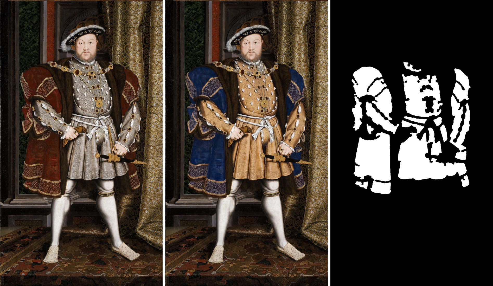

## The room and the site

The room is a Blender scene with no hand-edited file: one script builds walls, tunnel, beams, skylights, frames, camera path and the stops, and renders {{room.frames|int}} frames. The site is static: a canvas that scrubs {{site.frames}} WebP frames with the scroll, a high-resolution still at each of the {{room.works}} paintings, {{site.mb|.0f}} MB in total.

Almost every part was replaced after Marilyn looked at it, and those corrections are the useful record (`museo/BITACORA.md`): procedural frame ornaments "don't look realistic" → scanned CC0 frames from Poly Haven; a floor she disliked twice → polished concrete; a camera pan that felt "strange" → a body that walks, bobs and turns to face each painting; pixelated canvases → 3840 px sources and 2880 px stills.

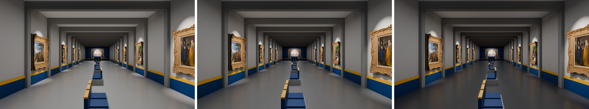

The final walkthrough, with the clean stadium model on the table, rendered in {{extra.room_final_min|.0f}} minutes ({{extra.room_final_spf|.1f}} s per frame, one run, from the file times of the first and last frame) with no errors in the log. The rebuilt site was opened in a desktop browser and scrolled to the model stop: the frame loads and the console is clean. That is the whole of the check — no phone, no load-time measurement.

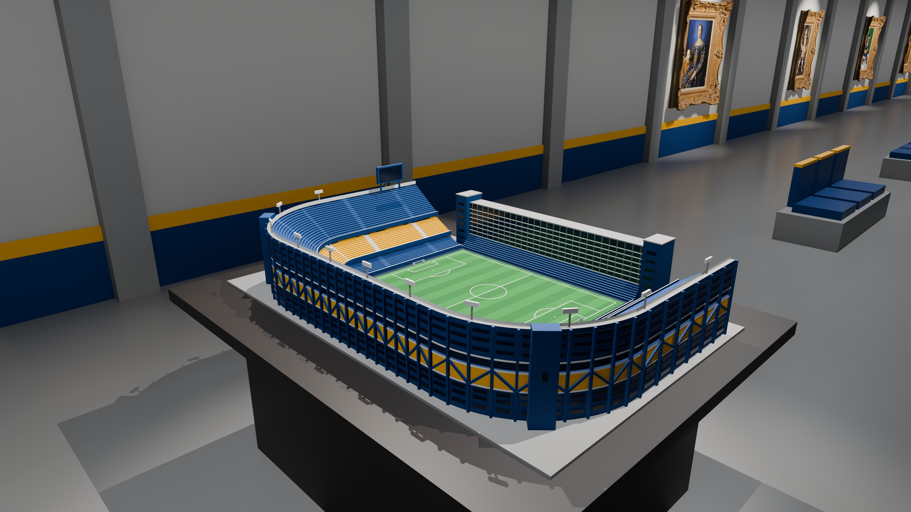
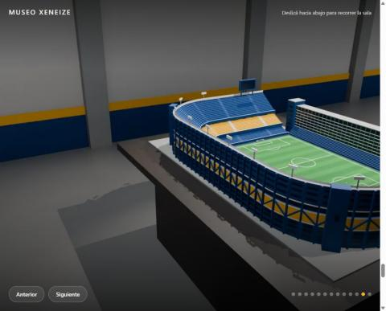

## What Tesseract was for

Honest answer to a question Marilyn asked half-way ("what is Tesseract helping with if we haven't used it?"): the room is Blender; Tesseract made the **{{tess.frames}}-frame path-traced intro video**. Importing the `.blend` lost the area lights, the procedural materials and the camera constraint, so lights were rebuilt in physical watts ({{extra.tess_lights_w.0}}, {{extra.tess_lights_w.1}} and {{extra.tess_lights_w.2}} W). The path tracer ran out of memory on the 6 GB card until every texture was shrunk to {{extra.tess_tex_px}} px.

**Table 4 — one 1080p frame, path tracer with denoise** (one measurement each).

| Samples | Seconds |
|---|---|
| 16 | {{extra.tess_spp16_s|.1f}} |
| 48 | {{extra.tess_spp48_s|.1f}} |
| 128 | {{extra.tess_spp128_s|.1f}} |

The export took {{tess.export_min|.0f}} minutes ({{tess.spf|.1f}} s per frame, from the CLI log). The bounced light is clearly better than EEVEE; the boxes are still boxes. Other people get hyper-real results from Tesseract because their models and materials are, not because of the renderer.

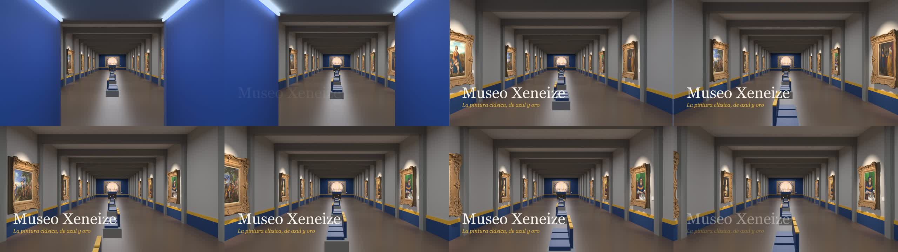

That first clip was one slow push down the room, and on the site it was hard to tell from the first frame of the walkthrough. Marilyn asked for a teaser with several viewpoints instead: {{extra.teaser_shots}} shots, {{extra.teaser_frames}} frames, {{extra.teaser_s|.0f}} seconds, one Tesseract project per shot joined with ffmpeg. It plays once on the site's cover, muted, and fades into the walkthrough. {{extra.teaser_shots_rendered}} shots were rendered; a low-angle one of the ceiling beams was cut after Marilyn saw it ("they add nothing" — there is no artwork up there).

Exporting it was the least reliable step of the project. The {{extra.teaser_shots_rendered}} shots that finished (the cut one included) took {{extra.teaser_export_h|.1f}} hours in total ({{extra.teaser_spf_min|.1f}}–{{extra.teaser_spf_max|.1f}} s per frame). The third shot failed twice first: once with "GPU device lost" at frame 29 of 72, and once by hanging at frame 61 for about {{extra.teaser_hang_h|.0f}} hours while still printing progress lines, which the retry loop could not see because nothing errored. A watchdog that kills the export after {{extra.teaser_stall_s}} s without a new frame fixed the loop; the cause of either failure is unknown (the laptop may have gone to sleep).

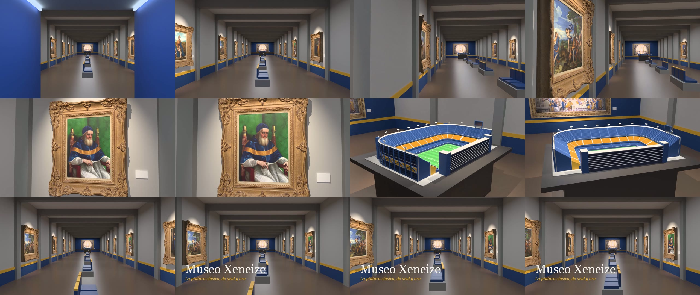

## Four attempts at one stadium

The room ends at a scale model of the stadium on a table. It took four routes, and the order matters.

**Table 5 — the stadium model.**

| Route | Input | Result | Marilyn's verdict | Cost |
|---|---|---|---|---|
| 1. Cubes placed by code, {{extra.code_models_rejected}} versions | memory, then aerial photos, then a reference render | recognisable, proportions by eye | "very basic", then "I don't see the reconstruction being precise" | 0 |
| 2. A ready-made model | three found online | none both free and reusable (one at US$ {{extra.marketplace_usd}} with an editorial licence) | not used | 0 |
| 3a. Normalise views with Nano Banana 2, then Tripo multiview | {{extra.cutouts_hand}} hand-cut aerial photos | {{m.m0003.vertices|int}} vertices; crisp, but the plan and the far side are invented | "we need a better 3D model" | {{m.m0001.credits|.1f}} + {{m.m0003.credits|.1f}} credits |
| 3b. Rodin Gen-2.5 on the real photos | the same {{extra.cutouts_hand}} cut-outs | {{m.m0005.vertices|int}} vertices; truer plan and pitch, soft tiers, washed colour, ragged edges | asked for clean modelling instead | {{m.m0005.credits|.2f}} credits |
| 4. Clean model from a building sheet | measurements of 3b + one rectified real photo + reading the {{extra.aerial_photos}} photos | {{extra.clean_faces|int}} faces in {{extra.clean_objects}} objects, swept along the plan | "I like it, let's use that one" | 0 |

What went wrong on the way, all logged:

- Cutting the stadium out of the photos by colour failed on {{extra.cutouts_auto_failed}} of {{extra.cutouts_auto_tried}}; the outlines were traced by hand.
- The "normalised views" step only half worked: a good front, a rotated middle panel, and a plan view instead of the back. The back fed to Tripo was the front **mirrored**, so that model has no real information about its far side.
- Two of {{runs.model3d}} 3D runs failed on mistakes Fable made wiring the graph, before reaching the service ({{runs.model3d_failed}} runs, no charge recorded).
- Tripo painted a crest and a kit-maker's mark on four corner towers, against the prompt and against the brand rule. They were painted over in the texture ({{extra.logos_px|int}} px); a faint outline remains.

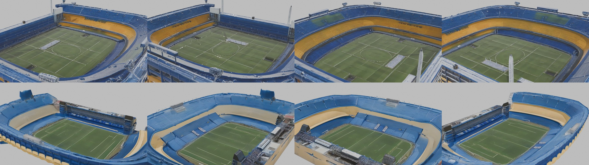

The fourth route is the one worth describing. Instead of asking a model for geometry, the generated mesh was **measured**: every vertex takes its texture colour, the green ones give the pitch — origin, axes and scale (105 m) — and from there come the outline every 3°, eight section cuts and the rim height (~{{extra.rodin_top_m}} m). A sanity check exposes the source: Rodin's pitch is {{extra.rodin_pitch_width_m|.1f}} m wide instead of 68. One real photo was rectified from the four pitch corners (check: the centre spot lands {{extra.photo_check_error_m|.1f}} m off) and gives about {{extra.photo_depth_m}} m from touchline to outer wall. Heights could not be measured from the photo: the camera calibration did not close. Everything went into a sheet with a source and a confidence for each number (`maqueta3d/ficha_edificio.md`) — most are "low" — and Blender swept tiers, parapets and wall along that plan.

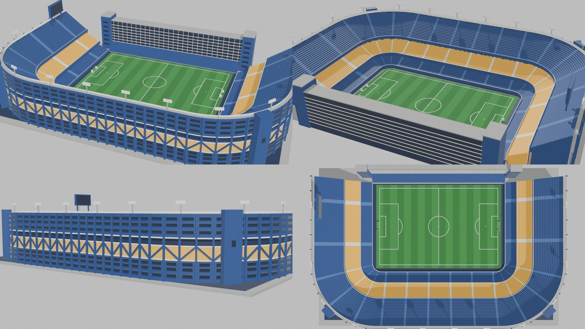

### What the comparison says

One object, one run per route and one person judging, so this holds for this case and is not a rule.

| | Tripo (normalised views) | Rodin (real photos) | Blender from the sheet |
|---|---|---|---|
| What decides the shape | the model, from one generated view and its mirror | the model, from 4 oblique photos | explicit measurements, each with a source |
| Surfaces | crisp from afar, melted up close | soft, ragged edges, bits of the neighbourhood | clean edges, parallel parts |
| Unrequested marks | added a crest and a kit-maker's logo | not checked up close | none: only what was modelled exists |
| Fixing one part | regenerate everything | regenerate everything | change one number in the sheet |
| Cost | {{m.m0001.credits|.1f}} + {{m.m0003.credits|.1f}} credits | {{m.m0005.credits|.2f}} credits | 0 |

- **For a building, image-to-3D did not give a usable model.** Both return something recognisable in minutes, but a stadium is regular, repeated geometry — rows, pilasters, bands — and every soft surface and invented part shows. Neither passed.
- **They were useful as a measuring instrument.** Rodin's plan and sections, scaled by the pitch, are what turned a model built by eye (rejected three times) into one with justified proportions. The {{m.m0005.credits|.0f}} credits bought measurements, not the final mesh.
- **What changed the outcome was the context, not the tool.** Routes 1 and 4 use the same Blender and the same language model. The fourth starts from a sheet of measurements and a way of building (sweeping profiles along the plan) instead of cubes arranged while looking at photos.
- **Normalising the views with a generative model is unproven**: one good view out of three, and the run that would show whether it helps (Tripo on the raw photos) was not done. Nor can the two services be ranked: one run each, different inputs.
- **The accepted model is cleaner and more controllable, not more accurate in a strict sense.** Its heights still come from a generated mesh that is ~6 % off.

## What it cost

**Table 6 — from the billing feed and the agents' end-of-run notices.**

| Stage | Backend | Runs | Cost |
|---|---|---|---|
| Pilots | Nano Banana 2 (Comfy Cloud) and local code | {{runs.pilots}} | {{credits.pilots|.2f}} credits |
| Evaluation: `edit` | Nano Banana 2, 4K | {{exp.conditions.edit.n}} | {{credits.eval_edits|.2f}} credits |
| Evaluation: `code` | {{agents.n}} Fable 5.2 agents | {{agents.n}} | {{agents.tokens_total|int}} tokens, {{agents.time_h|.1f}} h of agent time |
| Evaluation: `hybrid` | local composite | {{exp.conditions.hybrid.n}} | 0 |
| Five more paintings and one replacement | Nano Banana 2 + local mask | {{runs.second_batch}} | {{credits.second_batch|.2f}} credits |
| Stadium, image-to-3D | Nano Banana 2, Tripo, Rodin | {{runs.model3d}} ({{runs.model3d_failed}} failed) | {{credits.model3d|.2f}} credits |
| Room, video, site, clean model | Blender and Tesseract on a laptop | — | 0 |
| **Total** | | **{{runs.total}}** | **{{credits.total|.2f}} credits + {{agents.tokens_M|.2f}} M tokens** |

> Credits are Comfy Cloud's own figure per job, not an invoiced amount; no dollar conversion is available. Tokens for the conversation that directed all of this are not counted. The five later paintings were logged from the billing feed a day late, and which job made which painting was not written down; the replacement (*Henry VIII*) was logged when it ran.

## Honest limits

- **One evaluator, who is the author, and fast.** {{eval.answers}} answers in {{eval.duration_s|.0f}} seconds; {{eval.singles_under_1s}} of the {{eval.singles_answered}} single-image answers took under a second. She knew the methods and had seen results unblinded. The plan was three or four evaluators and an agreement score. *Closes it:* three people who have not seen the project, same page.
- **The baseline was not allowed to iterate; the code was** (up to four rounds). That favours the code, and it still did not win. *Closes it:* give the model four attempts and pick by the same rule.
- **Seeds pair only nominally**, and Nano Banana 2 does not return the same image for the same seed.
- **The folds metric fails on dark cloth** and the alteration metric is trivially zero for two of three methods. Neither was validated against a person before use.
- **Four paintings, one per difficulty level.** The split by painting is a pattern to test, not a result.
- **Half the museum is unmeasured**: the automatic hybrid was never evaluated.
- **The stadium is not a survey.** Its heights come from a generated mesh that is ~6 % off on the one dimension that could be checked. No plans were found. *Closes it:* drawings of the building, or photogrammetry with more than twelve photos.
- **The room is not photoreal**, the teaser has no sound and was checked on a twelve-frame sheet and one desktop playback, the site was not tested on phones, and Tesseract's two-critic review was skipped to save tokens.
- **Times are single measurements** on one machine.

## Reproduce it

- Hardware: Ryzen 9 4900HS, RTX 2060 Max-Q (6 GB), 15.4 GB RAM, Windows 11. Blender 5.1.2, Tesseract CLI 0.7.0.
- Models: Claude Fable 5.2 (agents and direction); Nano Banana 2 (Gemini 3.1 Flash Image), Tripo v3.1 multiview and Rodin Gen-2.5 through Comfy Cloud nodes.
- Experiment: protocol frozen at commit `032ee07`, evaluation at `bf7f79b`. `research/PROTOCOL.md` (with its change log), `runs.jsonl`, `results.json`, `eval-results.json`, raw outputs in `research/runs/`.
- Room and site: `scripts/blender_sala.py --stills --anim`, then `scripts/build_sitio.py`.
- Stadium: `scripts/blender_medir_estadio.py`, `research/maqueta3d/ficha_edificio.md`, `scripts/maqueta_limpia.py`.
- This report: `scripts/build_report_data.py`, then `render_report.py research/report.template.md research/report-data.json research/report.md`.
- Sources and licences: paintings in the public domain via Wikimedia Commons (`research/sources/README.md`, with hashes); aerial photographs by ProtoplasmaKid, CC BY-SA 4.0 — the 3D models derived from them carry the same terms; frames from Poly Haven, CC0.
